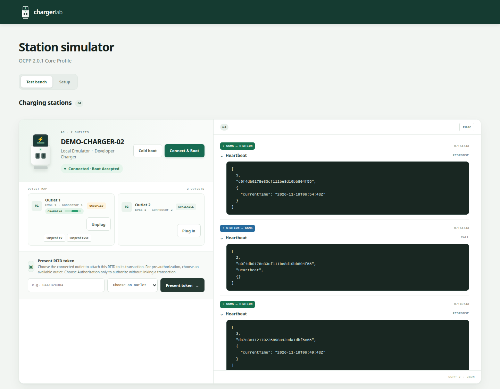
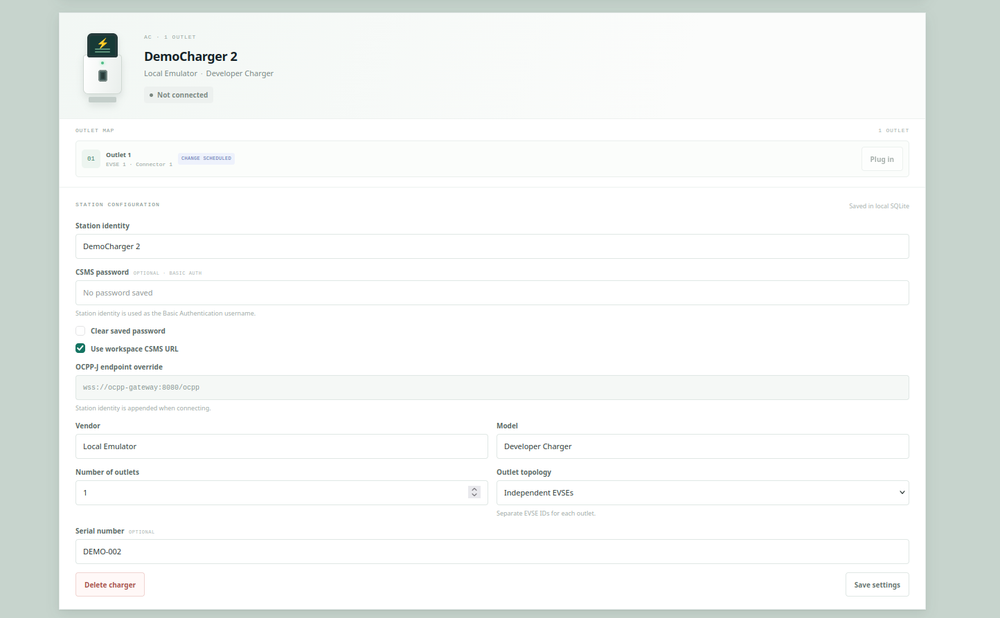

# Charger Lab

Charger Lab is a local OCPP 2.0.1 Charging Station emulator for developing and testing Charging Station Management Systems (CSMSs). It includes a browser test bench and a mock CSMS for trying the basic flow. It is not a physical charger, production service, or OCA-certified implementation.



## Install and run

You need Docker Engine with Docker Compose v2 and a web browser.

1. Clone this repository and change into its directory.
2. Start the containers:

   ```sh
   docker compose up --build
   ```

3. Open [http://127.0.0.1:8080](http://127.0.0.1:8080).

The first run builds the PHP image and starts the web app, station worker, and mock CSMS. The default charger is set up to connect to the mock CSMS.

To stop the containers, press **Ctrl+C** or run `docker compose down` in another terminal. Charger settings, outlet state, and exchange logs live in the `charger-data` Docker volume and remain after stopping the containers. To remove that test data too, run `docker compose down --volumes`.

## First test

In **Setup**, edit a charger's station identity, CSMS endpoint, password, station details, and outlet layout. The endpoint is the OCPP-J URL without the station identity; Charger Lab appends each charger's percent-encoded identity when it connects. `ws://` and `wss://` endpoints using the `ocpp2.0.1` subprotocol are supported.

Use **Test CSMS connection** to check the WebSocket handshake, TLS, Basic Authentication, and OCPP subprotocol. This check does not send `BootNotification`. Use **Connect & Boot** to start the OCPP session. In the test bench, simulate plugging in a vehicle, present an RFID token, suspend or resume charging, unplug, and inspect the message log. Add multiple charger cards to exercise more than one station.

The outlet layout supports 1–16 outlets:

- **Independent EVSEs** assigns one EVSE ID to each outlet, with connector ID 1.
- **Shared EVSE** assigns all outlets to EVSE 1, with a distinct connector ID for each outlet.



## Connect to another CSMS

The app and station worker run in containers. If your CSMS runs in a separate Compose project, attach both Charger Lab containers to its Docker network with the optional overlay:

```sh
CSMS_DOCKER_NETWORK=your-csms-project_default \
  docker compose -f compose.yaml -f compose.external-csms.yaml up --build
```

Set the CSMS URL in **Setup** to its Docker service name and container port, for example `wss://ocpp-gateway:8080/ocpp`. The named network must already exist. Find available networks with `docker network ls`.

For a CSMS running on the host, use `host.docker.internal` and a port reachable from the station-worker container. The Compose file adds this hostname for the worker on Linux. Keep TLS verification enabled: the URL hostname must match the CSMS certificate, and its issuing CA must be trusted. Add a private CA certificate in the workspace TLS settings if needed.

## Data and local access

The Compose setup publishes the browser app and mock CSMS on `127.0.0.1` only. The local browser API has no authentication, so keep it on the developer machine; do not expose it to a shared or public network. Use test credentials: CSMS passwords and workspace settings are persisted in the local SQLite data volume.

Local `.env` and `.env.*` files are excluded from the Docker build context so they are not copied into the image. `.env.example` is allowed for non-secret configuration examples.

## Implemented OCPP coverage

Charger Lab targets the OCPP 2.0.1 Core profile. The current implementation covers these areas:

- WebSocket boot, heartbeat, reconnect, TLS, and Basic Authentication.
- Local RFID authorization, remote start/stop, TransactionEvents, transaction status, and retry/offline delivery.
- Selected Device Model reads/writes and reports, network profiles, availability, reset, and TriggerMessage behavior.
- Simulated sampled and clock-aligned meter values.
- Simulated secure firmware-update and certificate-management flows, plus diagnostic and security log uploads.

This is a **subset implementation**, not a claim that every mandatory or conditional Core behavior has been implemented or passed. Charger Lab simulates station behavior and meter readings; it does not control or measure real charging hardware. Some OCPP actions and Device Model variables are unsupported.

## Conformance status

Repository unit and CSMS integration tests cover the behaviors described above. They do not replace OCA's Compliance Testing Tool (OCTT), and no OCTT result or OCA certification is claimed. The [Core conformance notes](docs/ocpp-2.0.1-core-compliance.md) list tracked areas and remaining PICS/OCTT verification gaps.

## Run the test suite

Install the development dependency and run both unit and integration tests:

```sh
composer install
composer test
```

The integration tests start local TCP services, so run them in an environment that permits localhost sockets.

## License

Charger Lab is licensed under the [Apache License 2.0](LICENSE).
